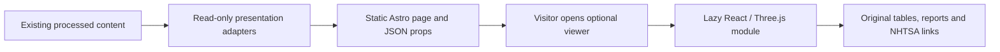

# Optional 3D visualization layer

This enhancement presents the existing published BrakeNews data. It does not run, retrain, modify or replace any analytical process. The original website remains the source of detailed evidence, official recall warnings and investigation text. Nothing is deployed by this implementation.

## Architecture and boundaries



- `src/lib/visualization/adapter.ts` copies fields from existing content. It has no network calls, filesystem writes, backend imports at runtime, scoring, classification or data collection. `types.ts` describes only the view's props; exported content schemas and API responses are unchanged.
- `ThreeExperience.astro` renders an original static SVG and a load button. React, Three.js and the model geometry load only after that button is clicked. Search and the rest of the page stay usable. Closing unmounts the scene; only one explorer may be active on a page.
- `three/VehicleExplorer.tsx` owns presentation state: selected system, camera, body style, color mode and replay. It does not write back to data or generate findings.
- `three/VehicleModel.tsx` contains three original procedural, unbranded shapes. `VehicleScene.tsx` provides the renderer and bounded camera controls. No remote model, texture, HDR environment, analytics or AI service is loaded.
- `three/ComplaintTimeline.tsx` replays only exported monthly problem counts. The methodology page's `WorkflowReplay.astro` is an explanation of completed offline processing, not a live agent workflow.

The existing vehicle summary, urgent recall notices, picker, SVG schematic, navigation, tables, charts and report text remain in their original components. Page integrations add imports, adapter props and a separate component. No pipeline, ML/NLP model, evaluation, API, exported data, deployment configuration or content schema was changed. The frontend test command includes additional adapter tests.

## What the viewer means

System IDs come from the existing `categoryOf` mapping. Transmission remains in “Engine & powertrain”; suspension and tires remain grouped with steering. No new complaint classifications were introduced. Electrical, driver assistance and other reports have text controls with no invented physical hotspot. Numbered regions are broad schematic locations, never confirmed defective parts.

| Display | Meaning |
| --- | --- |
| Neutral | Selection only; no metric-based colors. |
| Complaint counts | The largest existing individual problem count in each system. Brightness is scaled within this view. This is neither a new system total nor a cross-vehicle comparison. |
| Statistical flags | At least one listed problem has its existing flag set. Vehicle flags and report signal values are copied from their respective records. |
| Rising reports | At least one listed problem has its existing surge value set. |
| Matched recalls | At least one listed problem already has a matched recall ID. This is not VIN applicability. |
| Monthly replay | Only the chosen problem's count for that month; other regions receive no historical value. Current flags, recall links and estimates remain explicitly labeled current. |

Numerical detail remains available beside the colors. Unknown complaint counts and unknown report flags remain unavailable, rather than becoming zero or false. An uncolored region, an unflagged problem or the absence of a listed recall is not a safety assurance. Small voluntary complaint counts are not mechanical failure rates. The existing recall estimate is displayed without recalculating it and retains its 24-month horizon and methodology link.

## Historical limits

Most vehicle exports contain only a whole-vehicle monthly series. The viewer **does not split it into systems**, fabricate missing months or interpolate counts. Problem histories appear only when an existing published investigation supplies them for the same vehicle and data month. A report from another snapshot cannot enrich a vehicle's replay.

First signal and surge dates are labeled retrospective. Recall date markers require an existing `covers_this_problem` relation plus an available campaign date in the same vehicle/snapshot. Other-vehicle and unrelated recall relations do not become matches. Original recall relationships remain available in the report.

The exported series uses the current complaint grouping. It cannot establish exactly what was known at an earlier cutoff date, whether a prediction was issued then, or a historical recall probability. The UI says this explicitly. True “as known at the time” playback would require versioned historical exports with grouping, matching and publication timestamps. That is outside this frontend task and requires approval before any pipeline, schema or workflow work.

## Asset provenance

| Asset | Origin and rights | Fidelity |
| --- | --- | --- |
| `VehicleModel.tsx`: sedan, SUV, pickup | Original code-native geometry authored for this repository; covered by the repository's MIT license. No third-party vehicle mesh or branded design was copied or downloaded. | Generic illustrations, not replicas or generation matches. Body style is chosen explicitly by the visitor. |
| `public/images/vehicle-studio.svg` | Original vector illustration authored for this repository under the same license. | Static generic fallback, no vehicle-match claim. |
| Three.js / React Three Fiber | MIT-licensed dependencies; upstream notices remain in their packages. | Rendering libraries, not vehicle assets. |

Geometry is bundled as code and reused; there are no GLB downloads, textures or per-vehicle meshes. This is intentionally a lightweight first implementation. The data does not supply a reliable model-year-to-body-asset mapping, so the viewer does not infer one.

For a realistic vehicle pilot, obtain **one unbranded or properly authorized GLB for a documented make/model/generation and body configuration**, or a clearly identified generic model. Require a named creator/source, the full license permitting website redistribution and modification, attribution text, and any trademark restrictions. Target a compressed asset under 1 MB, simple materials, no embedded external resource URLs, and a static poster. Verify the model's generation against the chosen page before calling it a match. An explicit frontend-only asset map can then be reviewed; changes to exported schemas or technical workflows still require approval. No uncertain-license asset was downloaded.

## Accessibility and resource use

- Native buttons provide rotation, zoom, reset and system selection. A focusable view supports arrow keys, +/− and Home. Text controls and the original schematic/tables provide equivalent information without WebGL.
- Visible focus, native labeled selects/range input, status announcements, collapsible details and existing theme tokens apply throughout. No essential interaction requires dragging or color recognition.
- Reduced motion disables camera tweening, auto-rotation and timed replay; manual controls remain. Rotation is opt-in. Scene rendering uses `frameloop="demand"`; an idle scene has no continuous render loop. Animations stop offscreen or in a hidden tab. Replay stops when its panel leaves view.
- Pixel ratio is capped at 1.5. No realtime shadow maps or external environments are used. Controls, observers and procedural geometry/texture resources are cleaned up on close. WebGL loss falls back to the static illustration while keeping the evidence panel.
- A missing viewer chunk leaves the poster, retry button and original page. Without JavaScript, all original content and browsing still work. Closing 3D restores focus to its load button.

Rendering guidance: [React Three Fiber performance](https://r3f.docs.pmnd.rs/advanced/scaling-performance), [Three.js renderer lifecycle](https://threejs.org/docs/pages/WebGLRenderer.html).

## Checks and local review

From `site/`:

```sh
npm test
node node_modules/typescript/bin/tsc --noEmit
npm run build
npm run preview
```

Useful routes:

- `/`: optional studio and the existing searchable lookup.
- `/vehicles/honda/pilot/2025/`: multiple categories, flags and matched recalls.
- `/investigations/2026-honda-pilot-steering-wheel-clunks-or-clicks-when-turning/`: report-specific monthly replay.
- `/method/`: optional offline workflow explanation.

Adapter tests cover exact field preservation, frozen inputs, missing values, missing histories, cross-vehicle/snapshot isolation, recall-date matching and display-only color semantics.

Validation on 2026-11-09:

| Check | Result |
| --- | --- |
| Frontend unit tests | 13 passed, including the 7 existing vehicle-search tests. |
| TypeScript | `tsc --noEmit` passed. |
| Production build | 8,444 pages generated successfully. |
| Existing browser regression suite | 13 groups passed: search, keyboard/touch, dropdown browse, existing schematic, evidence navigation, urgent recall warnings, trust copy, no-JavaScript content, error states and accessibility. |
| New viewer browser checks | 9 groups passed: lazy loading, all body styles, camera/keyboard controls, a direct hotspot click, source counts/categories, all color modes, exact monthly replay, reduced motion, close/reopen, graphics/network fallbacks, offline workflow and mobile search order. |
| Automated accessibility | No axe violations in the inspected viewer states, including selected/hovered controls, report replay and dark mobile view. |
| Protected source/data check | SHA-256 comparison of 1,168 pre-edit pipeline, test, data, schema, API-export and configuration files: zero changes. Git review confirms changes are confined to the frontend and its documentation/dependencies. |

Chromium desktop and 390/320px mobile layouts were inspected. Headless 3D used software WebGL. The idle viewer stopped scheduling animation frames after camera movement settled. Network inspection confirmed that the renderer and React client were absent before opening the viewer. The initial loader is approximately 1.4 KiB gzipped; the optional viewer plus React client is approximately 312 KiB gzipped. Vite reports a non-blocking large-chunk warning for the optional renderer's uncompressed bundle; this chunk is already loaded on demand. No build configuration was changed to suppress the warning.

Local screenshots and a recorded demonstration are in `/private/tmp/brakenews-3d-qa/`; the demo is `brakenews-3d-demo.webm`. Browser artifacts are local QA outputs, not published website assets. Temporary preview servers were stopped after the checks.

## Recommendation

Keep the generic explorer optional and test comprehension before commissioning realistic assets for many vehicles. Its useful contribution is linking broad systems to evidence and replaying an existing problem history. Rotation alone does not improve analytical accuracy. A small moderated test should ask visitors to identify the selected vehicle, distinguish a complaint/flag/recall, find the original evidence and check VIN applicability, comparing the original schematic with the optional 3D view. No engagement tracking, accounts, alerts or new analytics collection was added.

Real-device GPU performance, Safari/Firefox behavior and user comprehension still require separate evaluation. The local headless browser uses software WebGL, so its frame rate is not evidence of a mobile GPU frame-rate target.
